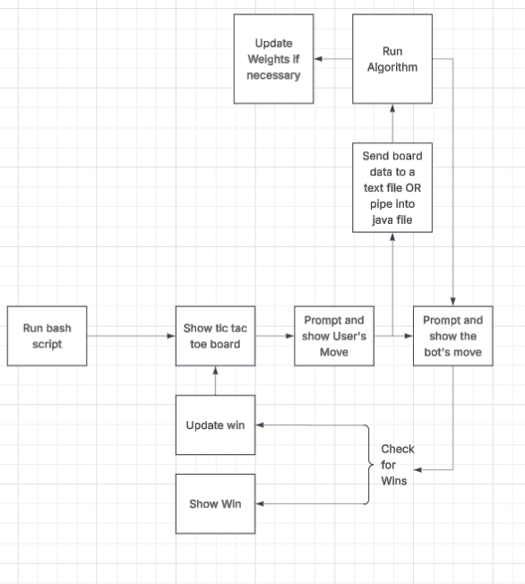

# Project Name

A simple tic tac toe game that you can run in the terminal. Supports playing against AI

## The Problem

I want to see how AI works underneath the hood, so I want to simulate a little algorithm that uses positive reinforcement. 

## How It Works


## Tech Stack

- **Language:** Bash / Java
- **Libraries/Commands:** piping, echo, cat, arrayList, BufferedReader, FileReader, Random

## Setup
Requires Java 14+

run this command to start it up
```bash
git clone https://github.com/hexagone584/Tic-Tac-Toe
cd Tic-Tac-Toe
```
you should be in the `Tic-Tac-Toe` directory

## Usage
Run the bash script. there are three options:

if you want to play against menace, run this:
```bash
./start.sh main
```

if you want menace to play against a bot that does random moves or a bot that never loses, run this:
(replace `AgainstRandom` with `AgainstMiniMax`)
```bash
./start.sh AgainstRandom 500
```

## Roadmap

- [X] Build tic-tac-toe in bash
- [X] pipe board into java to check for wins
- [X] make bot w/ reinforcement learning
- [ ] collect data for the bot

## Author

Jackie Yang, https://github.com/hexagone584
